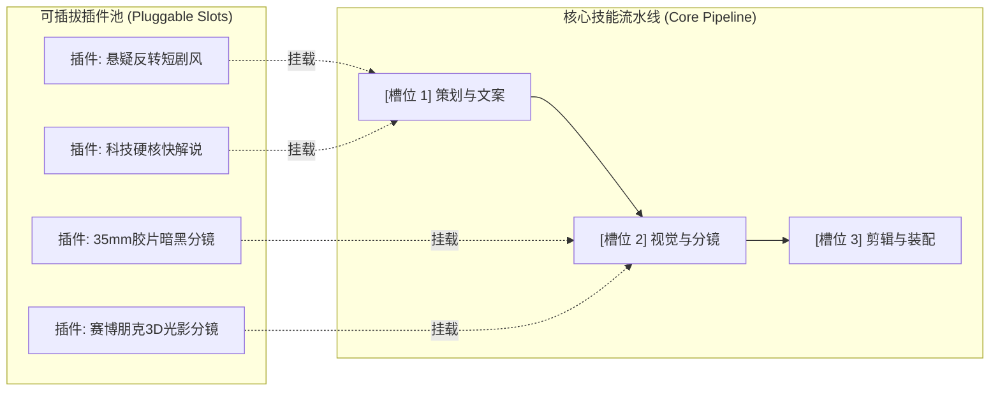

# Pluggable Skills (可插拔智能体技能架构)

> **Defeat Homogenization: A Microkernel & Slot-based Pluggable Architecture for AI Agent Skills.**
> 告别 AI 同质化：基于微内核与槽位机制的可插拔智能体技能规范与轻量引擎。

[中文](README.md) | [English](README_EN.md)

[](./LICENSE)
[]()
[]()

---

## 🎯 痛点与解决思路

### 1. 传统 AI Agent Skills 的“同质化灾难”
目前大多数 Agent Skills / Prompt 工程都写成了一个又臭又长的**“全包大单体”**：
* **千篇一律**：做视频全是营销号味，写文章全是公文包风，写代码无脑套模式。
* **难以维护**：为了做一个科技风视频和一个悬疑短剧，开发者不得不复制两份 90% 逻辑雷同的巨大技能文件。
* **容易崩溃**：在 Prompt 里加了一句风格约束，经常污染了后续的步骤，导致输出结构错乱。

### 2. 第一性原理破解：解耦“流程骨干”与“个性灵魂”
我们将技能抽象为两层：
$$\text{产物差异化 (Diversity)} = \text{核心流水线 (Core Pipeline)} \times \prod_{i=1}^{n} \text{槽位插件}_i (\text{Slot Plugin}_i)$$

* 🦴 **核心技能流水线（Core Skill）**：只负责生命周期调度与数据契约输出（保证结构 100% 稳定，绝不崩溃）。
* 🎨 **槽位插件（Slot Plugins）**：纯文本、单文件、填空式，按需为特定环节注入审美、Prompt 约束和词库（保证针对性与风格多样）。



---

## ✨ 核心特性

1. ⚡ **零代码门槛（极好开发）**：开发一个插件就像填一张 Markdown 表格，3分钟即可为任意槽位注入全新风格。
2. 🛡️ **严格契约与沙箱隔离（极度稳定）**：
   * **单步即焚**：插件提示词只在对应槽位临时生效，不污染上下游。
   * **自动自愈**：内置 `ContractValidator`，即使插件导致漏填字段，系统自动触发 Fallback 补全，流程永不阻断。
3. 📦 **轻量 KISS 原则**：核心引擎 **0 外部重型依赖**（仅依赖 Python 3 标准库），开箱即用。
4. 🌐 **全场景通用**：已开箱提供**视频创作**与**自媒体爆文**两大落地实战示例。

---

## 🚀 30秒快速上手

### 1. 运行视频创作场景演示
验证同一主题在挂载不同插件时，瞬间生成【悬疑短剧】与【硬核科技】两种完全不撞车的成片案：

```bash
# 运行视频流水线演示
python examples/01_video_producer/demo.py
```

### 2. 运行自媒体文案场景演示
验证同一新闻选题，通过挂载不同插件，分别生成【毒舌辛辣锐评】与【温情治愈深度】两种爆款文案：

```bash
# 运行文案流水线演示
python examples/02_copywriting/demo.py
```

---

## 🛠️ 3分钟制作你的专属插件

开发者只需在 `plugins/` 目录下创建一个 `.md` 文件并填空：

```markdown
---
spec_version: "1.0"
slot: "script_generation"          # 挂载到哪个槽位
id: "my-humor-script"             # 唯一ID
name: "脱口秀幽默风"               # 插件名称
version: "1.0.0"
description: "用脱口秀段子解构严肃议题"
---

## 核心风格规约
- 每 20 秒设置一个反讽笑点。
- 善用自嘲，用生活中的琐事隐喻宏大技术。

## 黄金范例
- 标题：《学了三年AI，它学会了替我加班，我学会了替它背锅》
```

就这么简单！将其存为 `my_plugin.md`，即可在流水线中通过一行代码挂载：
```python
engine.mount_plugin("plugins/my_humor_script.md")
```

---

## 📂 仓库目录结构

```text
pluggable-skills/
├── README.md                      # 本文档
├── LICENSE                        # MIT 开源协议
├── specification/
│   └── spec_v1.md                 # Pluggable Skills Spec v1.0 协议规范
├── templates/
│   ├── plugin.template.md         # 填空式插件模版 (开箱即用)
│   └── pipeline.template.json     # 流水线契约定义模版
├── core/                          # 极简核心编排引擎 (零外部依赖)
│   ├── __init__.py
│   ├── engine.py                  # 沙箱注入与调度器
│   └── validator.py               # 契约校验与自愈补全
└── examples/
    ├── 01_video_producer/         # 视频创作全流程落地实战
    │   ├── pipeline.json
    │   ├── demo.py
    │   └── plugins/               # 4款各具特色的音视频插件
    └── 02_copywriting/            # 自媒体写作落地实战
        ├── pipeline.json
        ├── demo.py
        └── plugins/               # 2款反差强烈的文风插件
```

---

## 🤝 参与贡献

我们欢迎社区贡献针对各行各业的**高质量槽位插件**（如：动画分镜、电商直播、游戏NPC对话、代码极客重构等）！
详情请参阅 [specification/spec_v1.md](./specification/spec_v1.md)。

## 📄 开源许可证

本项目基于 [MIT License](./LICENSE) 协议开源。
