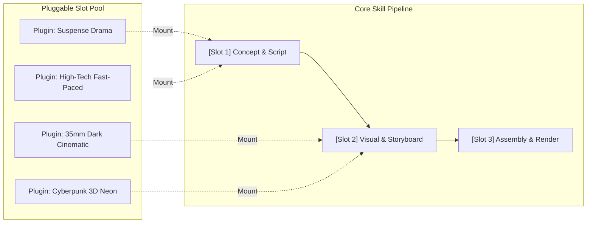

# Pluggable Skills

> **Defeat Homogenization: A Microkernel & Slot-based Pluggable Architecture for AI Agent Skills.**

[English](README_EN.md) | [中文](README.md)

[](./LICENSE)
[]()
[]()

> 🎬 **Official End-to-End Production Video Showcase (with Edge-TTS & MP4 Rendering)**:  
> Check out the dedicated implementation repo 👉 [**pluggable-video-producer**](https://github.com/Ikaros-521/pluggable-video-producer) to see how the same footage yields two radically distinct videos in under 15 seconds.

---

## 🎯 The Pain Point & Philosophy

### 1. The "Homogenization Crisis" of AI Agent Skills
Most AI Agent skills and prompt engineering setups suffer from the **"monolithic hardcoding dilemma"**:
* **Carbon-Copy Outputs**: Video generation sounds like generic commercial clickbait, articles read like corporate fluff, and generated code mindlessly over-engineers design patterns.
* **Maintenance Hell**: To support both a "tech breakdown" video and a "suspense thriller" drama, developers often duplicate monolithic skill files where 90% of the workflow logic is identical.
* **Context Bleed & Fragility**: A single styling instruction in an early step often contaminates subsequent pipeline stages, leading to schema drift and pipeline crashes.

### 2. First Principles Solution: Decouple Pipeline from Personality
We decompose agent workflows into two clean layers:

$$\text{Diversity} = \text{Core Pipeline} \times \prod_{i=1}^{n} \text{Slot Plugin}_i$$

* 🦴 **Core Pipeline**: Controls the deterministic state machine, lifecycle hooks, and schema validation. Guarantees 100% structural stability.
* 🎨 **Slot Plugins**: Lightweight, single-file Markdown configurations that inject domain tone, vocabulary, and few-shot examples into specific slots.



---

## ✨ Key Features

1. ⚡ **Zero-Code Plugin Authoring**: Writing a plugin takes under 3 minutes. Just copy a template Markdown file and fill in your desired tone, guidelines, and few-shot samples.
2. 🛡️ **Sandbox Isolation & Schema Invariance**:
   * **Ephemeral Injection**: Plugin directives exist only during the execution of their designated slot. Downstream steps receive only cleaned structured data, preventing style contamination.
   * **Zero-Crash Fallback**: Built-in `ContractValidator` automatically patches missing fields with defaults if a third-party plugin hallucinates.
3. 📦 **KISS Principle**: Pure Python 3 standard library with **zero external heavy dependencies**.
4. 🌐 **Multi-Domain Applicability**: Ships with production-ready examples for **video production** and **content copywriting**.

---

## 🚀 Quickstart (30 Seconds)

### 1. Run the Video Producer Example
Witness how the same topic produces two completely distinct, non-homogenized video packages simply by swapping plugins:

```bash
# Run the video pipeline demo
python examples/01_video_producer/demo.py
```

### 2. Run the Copywriting Example
See the same news topic transform into either a "Sharp Sarcastic Critique" or a "Warm Healing Narrative":

```bash
# Run the copywriting pipeline demo
python examples/02_copywriting/demo.py
```

---

## 🛠️ Build Your Custom Plugin in 3 Minutes

Create a `.md` file in `plugins/` and fill in the blanks:

```markdown
---
spec_version: "1.0"
slot: "script_generation"          # Target slot ID
id: "standup-comedy"               # Unique ID
name: "Standup Comedy Style"       # Human-readable name
version: "1.0.0"
description: "Deconstruct serious tech topics with humor and irony"
---

## Core Directives
- Inject a self-deprecating punchline every 20 seconds.
- Avoid corporate jargon; explain high-tech with absurd real-life analogies.

## Golden Few-Shot Sample
- Title: "I Spent 3 Years Learning AI: Now It Works My Overtime, and I Take Its Blame"
```

Mount it in your pipeline with a single call:
```python
engine.mount_plugin("plugins/standup_comedy.md")
```

---

## 📂 Project Structure

```text
pluggable-skills/
├── README.md                      # Chinese documentation
├── README_EN.md                   # English documentation (this file)
├── LICENSE                        # MIT License
├── specification/
│   └── spec_v1.md                 # Pluggable Skills Spec v1.0 Standard
├── templates/
│   ├── plugin.template.md         # Ready-to-use plugin scaffold
│   └── pipeline.template.json     # Pipeline schema template
├── core/                          # Lightweight engine (Zero dependencies)
│   ├── __init__.py
│   ├── engine.py                  # Sandboxed execution & orchestrator
│   └── validator.py               # Schema validation & fallback auto-repair
└── examples/
    ├── 01_video_producer/         # Video production case study
    │   ├── pipeline.json
    │   ├── demo.py
    │   └── plugins/               # 4 distinct audio/visual plugins
    └── 02_copywriting/            # Copywriting case study
        ├── pipeline.json
        ├── demo.py
        └── plugins/               # 2 contrasting style plugins
```

---

## 🤝 Contributing

We welcome community-contributed slot plugins for diverse domains (e.g., anime storyboard, e-commerce livestream, game NPC dialogue, code refactoring). Please review [specification/spec_v1.md](./specification/spec_v1.md) before submitting a PR.

## 📄 License

This project is licensed under the [MIT License](./LICENSE).
