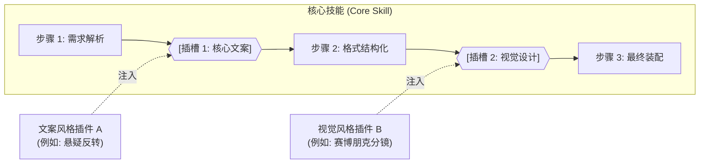

# Pluggable Skills 规范协议 (Spec v1.0)

> **目标**：解决智能体技能（Agent Skills）同质化严重、难以复用、定制成本高昂的痛点，将“插件化扩展”无缝融入“技能流水线”。

---

## 1. 核心架构理念

### 1.1 痛点剖析：传统技能的三重困境
1. **大单体硬编码（Monolithic Hardcoding）**：流程逻辑、文风偏好、提示词工程揉在单个文件里，改一处动全身。
2. **严重的同质化（Homogenization）**：全网 AI 产物千篇一律，想要做出不同风格，就必须克隆并维护一堆重复的 Skill 代码。
3. **脆弱的稳定性（Context Fragility）**：用户自定义 Prompt 容易污染后续执行环节，导致格式崩溃。

### 1.2 第一性原理公式
$$\text{产物差异化 (Diversity)} = \text{核心流水线 (Core Pipeline)} \times \prod_{i=1}^{n} \text{槽位插件}_i (\text{Slot Plugin}_i)$$

* **核心技能（Core Skill）**：负责**骨架与秩序**。控制生命周期状态机，保证产物结构的稳定可靠。
* **槽位插件（Slot Plugin）**：负责**血肉与灵魂**。按需插拔，只关注特定切面的审美、领域知识与 Prompt 约束。



---

## 2. 规范定义

### 2.1 槽位（Slot）
流水线中的一个扩展点。每个槽位必须具备：
* **`slot_id`**：槽位唯一标识（如 `script_style`、`visual_prompt`）。
* **`input_contract`**：传入该槽位的数据格式。
* **`output_contract`**：该槽位必须产出的数据格式（JSON Schema 或固定结构字段）。

### 2.2 插件（Plugin）
插件是面向领域创作者的轻量载体，遵循 **“单文件纯文本规范（Single-file Markdown）”**。

插件文件的头部必须包含 YAML FrontMatter 元数据：

```markdown
---
spec_version: 1.0
slot: <目标槽位ID>
id: <插件唯一英文ID>
name: <人类可读名称>
version: 1.0.0
author: <作者>
description: <一句话描述该插件的针对性与特色>
tags: [<标签1>, <标签2>]
---

## 1. 核心调性与约束 (Directives)
[说明该插件的风格、思考逻辑、硬性规约]

## 2. 专用词库/技术参数 (Vocabulary & Parameters)
[特定领域名词、画面提示词关键词、Lora参数等]

## 3. 示例样本 (Few-Shot Examples)
[提供 1~2 个高质量输入输出样例，供模型直接学习其风格]
```

---

## 3. 稳定性保障三原则 (Invariance & Stability)

为确保不论插件质量如何，系统始终稳定运行，执行引擎必须遵守以下三条原则：

### 原则一：结构不可变性（Schema Invariance）
插件**只能决定内容风格与专业度**，绝不能破坏步骤既定的数据结构。若槽位要求输出字段包含 `[hook, body, punchline]`，插件不得擅自增删字段。

### 原则二：单步沙箱即焚（Ephemeral Context Injection）
插件的提示词**仅在当前槽位执行的那一步临时拼装**。
槽位执行完毕后，引擎必须对产物进行清洗，**只向下游传递清洗后的结构化数据**，彻底抛弃该插件的提示词，杜绝“风格污染下游”。

### 原则三：零崩溃兜底（Zero-Crash Fallback）
每个槽位必须内置一个 **Default Fallback 预设**。若挂载的第三方插件因幻觉或指令冲突导致产物无法通过契约校验，引擎应自动降级至默认规则，保障流程顺利完结。
